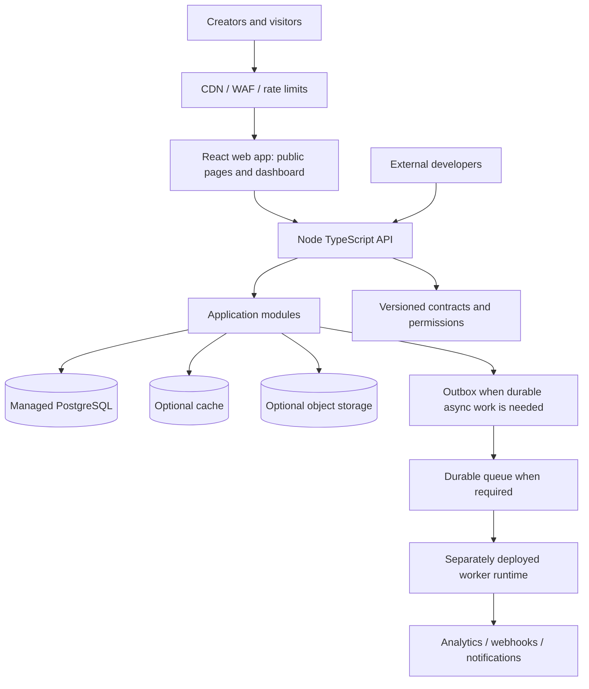

# Architecture

## 1. Status and strategy

**Status: Proposed; awaiting user approval.** This document defines the intended architecture, not a claim that these technologies are already implemented.

Start with a **TypeScript monorepo and modular monolith**. Deploy the web frontend and Node API as separate Vercel projects or separately configured deployments from one repository when practical. Keep domain and application code independent of deployment adapters so a workload can move to another runtime later.

Do not begin with a fleet of microservices. Preserve clear module boundaries and versioned contracts; extract a service only when independently scaling, security, reliability, or ownership needs are demonstrated.

## 2. Technology direction

- **Frontend:** React Router in Framework Mode, TypeScript, SSR for dynamic public profiles, with static prerendering where appropriate.
- **Backend:** Node.js + TypeScript + Fastify for the versioned HTTP API.
- **Hosting:** Vercel for initial web and API deployments.
- **Database:** managed PostgreSQL as the source of truth, accessed through Prisma ORM.
- **Workspace:** npm workspaces with a committed `package-lock.json`.
- **Contracts:** shared schema/contract package for request/response validation and API SDK types.
- **CDN:** Vercel CDN/edge caching for public profile output and static assets.
- Add object storage, cache, queue, and worker infrastructure only when required.

### Important rendering decision

A pure client-rendered React SPA is simple for dashboards but is a weaker default for indexable, fast public creator pages. Keep React as the UI technology, but prefer a React framework/rendering mode that supports server rendering or static prerendering. React Router Framework Mode is selected. Vercel documents a React Router integration and recommends the `@vercel/react-router` preset for SSR deployments; verify the exact framework and adapter versions at implementation time.

### Important Vercel boundary

Vercel is a good initial fit for request/response web and API workloads, but do not design long-running or continuously polling background jobs around request functions. Analytics aggregation, scheduled jobs, durable retries, and high-volume event processing may require a queue plus a separate worker runtime later. Keep worker code deployable independently.

## 3. Logical architecture

This is a target logical view. Optional infrastructure is not an MVP deployment requirement.

## 4. Monorepo proposal

See [PROJECT_STRUCTURE.md](PROJECT_STRUCTURE.md). Proposed workspace boundaries:

- `apps/web`: React routes, page composition, public rendering, dashboard UI.
- `apps/api`: Node HTTP adapter, middleware, authentication integration, API routes.
- `apps/worker`: future async consumers; do not create until a real job requires it.
- `packages/contracts`: versioned schemas and API contracts, without database or framework dependencies.
- `packages/sdk`: future developer SDK generated from or aligned with the public API contract.
- `packages/config`: shared TypeScript/lint/test configuration where genuinely useful.
- `docs`: product, architecture, ADRs, security, API lifecycle, and operations.

Use npm workspaces, declared in the root `package.json`, and commit `package-lock.json` for reproducible installs. Avoid making a shared package for every trivial helper.

## 5. Module boundaries

Initial domain modules:
- **Identity & Accounts:** account lifecycle and authentication-provider mapping.
- **Profiles:** profile ownership, normalized slug, publication state, public profile projection.
- **Links:** validated destinations, ordering, enabled state, redirects.
- **Themes & Media:** validated theme configuration and media metadata.
- **Analytics:** event intake, aggregation, retention, exports.
- **Developer Platform (later):** API keys, scopes, quotas, API versioning, SDKs, developer documentation.
- **Webhooks (later):** subscriptions, event schemas, signatures, retries, delivery logs, replay controls.
- **Integrations (later):** provider adapters and installation lifecycle.
- **Teams (later):** organizations, membership, roles, invitations.
- **Billing (later):** plans, entitlements, subscription lifecycle.

Every module owns its business rules, application use cases, input/output schemas, persistence interfaces, and authorization expectations. Other modules call its public application contract instead of querying its tables directly.

## 6. Dependency rules

1. React UI calls typed API clients; it does not access the database.
2. HTTP route handlers authenticate, validate, call a use case, and map the result to an HTTP response.
3. Application use cases orchestrate domain rules and infrastructure interfaces.
4. Domain code must not import React, the HTTP framework, ORM, cache SDK, queue SDK, or cloud-provider SDK.
5. Infrastructure implements repository, storage, queue, and provider interfaces.
6. Cross-module writes must go through the owning module's use case or an explicit domain/event contract.
7. Avoid circular dependencies and giant shared utility packages.
8. Validate input at trust boundaries. Shared schemas help consistency but server validation remains mandatory.
9. API response DTOs are explicit and stable; never serialize ORM entities directly.

## 7. Developer platform principles

Developer features are a first-class architectural concern, but should be delivered in stages.

### Versioned API
- Start with a documented versioning policy, for example `/api/v1`.
- Define consistent error envelopes, pagination, filtering, request IDs, and rate-limit headers.
- Use idempotency keys for operations where safe retries could duplicate side effects.
- Define compatibility and deprecation policies before external adoption.
- Keep public API contracts separate from internal database schemas.

### API keys and authorization
- Store only a cryptographic hash of a newly generated API secret; show the secret once.
- Support revocation, rotation, expiry where appropriate, scopes, per-account ownership, and audit history.
- Enforce authorization and quotas on every request; never trust a scope supplied by the client.
- Keep session cookies, internal credentials, and developer API keys distinct.
- Do not put long-lived secrets in browser bundles.

### Webhooks
- Deliver only versioned, documented events.
- Sign each delivery with a secret and timestamp; document verification and replay protection.
- Retry transient failures with bounded exponential backoff and jitter.
- Use idempotent delivery IDs, delivery logs, manual replay, and dead-letter handling.
- Treat delivery as at-least-once, not exactly-once.
- Prevent server-side request forgery: validate destinations and block private, loopback, link-local, and metadata addresses; revalidate DNS/redirect behavior at delivery time.

### Extensions and integrations
- Begin with outbound webhooks and supported integrations, not arbitrary executable plugins.
- Define permission scopes, install/uninstall lifecycle, secret handling, rate limits, and audit logs.
- If third-party code execution is introduced later, use a separate sandbox/isolation boundary and resource quotas. Never evaluate submitted code inside the core API process.

## 8. Database and persistence

- PostgreSQL is the source of truth for accounts, profiles, links, permissions, API-key metadata, and webhook configuration.
- Use Prisma ORM with reviewed, committed Prisma migrations. Keep schema changes and generated client setup explicit in workspace scripts.
- Enforce unique normalized usernames and other durable invariants with database constraints.
- Use indexes based on observed query patterns and query plans.
- Use cursor/keyset pagination for large lists and API endpoints.
- Keep connection pools bounded and account for serverless concurrency. Configure a pooled runtime connection URL where the database provider supports it and a direct/migration URL where Prisma migrations require it; never allow each function instance to open unbounded connections.
- Keep transactions short and never make third-party network calls inside a database transaction.
- Design migrations using expand/migrate/contract for safe deployments.
- Document backup, restore, and disaster-recovery procedures.

## 9. Public profile read path

1. Visitor requests a profile URL.
2. Edge layer applies TLS, WAF/bot protections, and rate limits.
3. React rendering layer resolves a normalized slug and published profile.
4. Server fetches only the fields needed for the public view.
5. Cache public content using a stable key plus content version or a clear invalidation strategy.
6. On publish/unpublish/update, invalidate or version-bust the public representation.
7. Capture analytics without blocking the user's navigation.

Never share-cache private dashboard responses. Account for unpublishing, deletion, slug changes, and disabled links.

## 10. Analytics and asynchronous work

- Click navigation should not wait for heavy analytics work.
- Validate event type, profile/link relationship, and payload size.
- Apply rate limits and bot filtering.
- Begin with a simple durable approach if volume is low; introduce queue-backed ingestion when justified.
- Workers must tolerate duplicates and retry safely.
- Use an outbox when a database change must reliably trigger an event.
- Define retention, aggregation, and privacy rules before collecting detailed attribution.
- Keep product analytics separate from operational logs.

## 11. Vercel deployment and portability

- Keep `apps/web` and `apps/api` independently buildable and deployable.
- Use the official React Router Vercel preset for SSR where applicable, and validate route caching and invalidation carefully.
- Deploy Fastify through Vercel's supported Fastify/Function integration; treat it as request/response serverless compute, not a guaranteed persistent Node process.
- Use environment-specific configuration and validate required variables at startup/build boundaries.
- Avoid reliance on local disk persistence, sticky sessions, or in-memory shared state.
- Use provider-neutral interfaces around database, cache, storage, queues, email, and webhooks.
- Ensure database connection usage matches serverless concurrency.
- Keep long-running workers outside request handlers and independently deployable.
- Fastify is supported on Vercel as a Function, but Vercel Function constraints (including bundle-size and runtime limits) still apply. Verify current limits and cold-start/connection behavior before deployment configuration is finalized.

## 12. Scaling path

### Stage 1 — Foundation and MVP
React web app, Node API, PostgreSQL, basic CDN, tests, structured logs, and access control.

### Stage 2 — Developer-ready core
Stable API v1, documented error/pagination patterns, API contract tests, developer docs, and initial SDK strategy.

### Stage 3 — Growth
Cache hot public profiles, add rate limiting, queue-backed analytics/webhooks, and worker runtime where required. Load-test public pages and redirects.

### Stage 4 — Platform scale
API key scopes/quotas, signed webhooks, delivery logs, integration lifecycle, organization permissions, and usage metering.

### Stage 5 — High traffic
Scale stateless API/web deployments, optimize database queries/pooling, separate analytics workloads, and introduce read replicas or partitioning only when measurements justify them.

### Stage 6 — Selective service extraction
Extract a module only when its scale, ownership, isolation, or release requirements justify a separate service. Define data ownership, API/event contracts, timeouts, retries, telemetry, migration, and rollback first.

## 13. Security

- Authorize every private operation server-side.
- Use secure, HTTP-only, same-site cookies if cookie-based sessions are selected; protect state-changing requests against CSRF where applicable.
- Validate URL schemes; reject dangerous schemes such as `javascript:`.
- Escape user-generated content and do not render arbitrary user HTML.
- Rate-limit authentication, mutations, redirects, API keys, and event ingestion.
- Redact secrets and personal data from logs.
- Enforce tenant isolation and test cross-account access.
- Store API-key hashes, support revocation, and never return a secret after initial creation.
- Verify ownership of custom domains before serving tenant content.
- Webhook delivery must resist SSRF and replay.
- Define account export/deletion and analytics retention policies.

## 14. Observability and testing

- Structured logs with request/correlation IDs.
- Metrics for request rate, latency, errors, database pool saturation, cache hit ratio, queue age, retries, webhook outcomes, and rate-limit decisions.
- Unit tests for domain rules; integration tests for database and adapters; API tests for auth/validation; E2E tests for publish flow.
- Contract tests for API clients, webhooks, and SDKs.
- Load tests for public pages, redirects, and rate-limit enforcement.
- Test cross-tenant access, cache leakage, key revocation, webhook signature verification, and SSRF defenses.
- Alerts should reflect user impact and defined service objectives.

## 15. Upgrade and compatibility policy

- Keep domain models separate from persistence and transport DTOs. Prisma is an infrastructure adapter, not a domain dependency.
- Version external APIs and event schemas.
- Add optional fields before removing or renaming fields.
- Maintain backward-compatible migrations and queue consumers.
- Use feature flags and gradual rollouts for risky changes.
- Maintain ADRs for important choices and record why alternatives were rejected.

## 16. Service extraction criteria

Extract a module only when there is evidence of one or more:
- distinct scaling requirements,
- independent availability/security boundary,
- separate team and ownership,
- release cadence or failure modes materially affecting other modules.

Every extraction requires a data ownership plan, contract tests, observability, retry/timeout rules, deployment strategy, and rollback path.