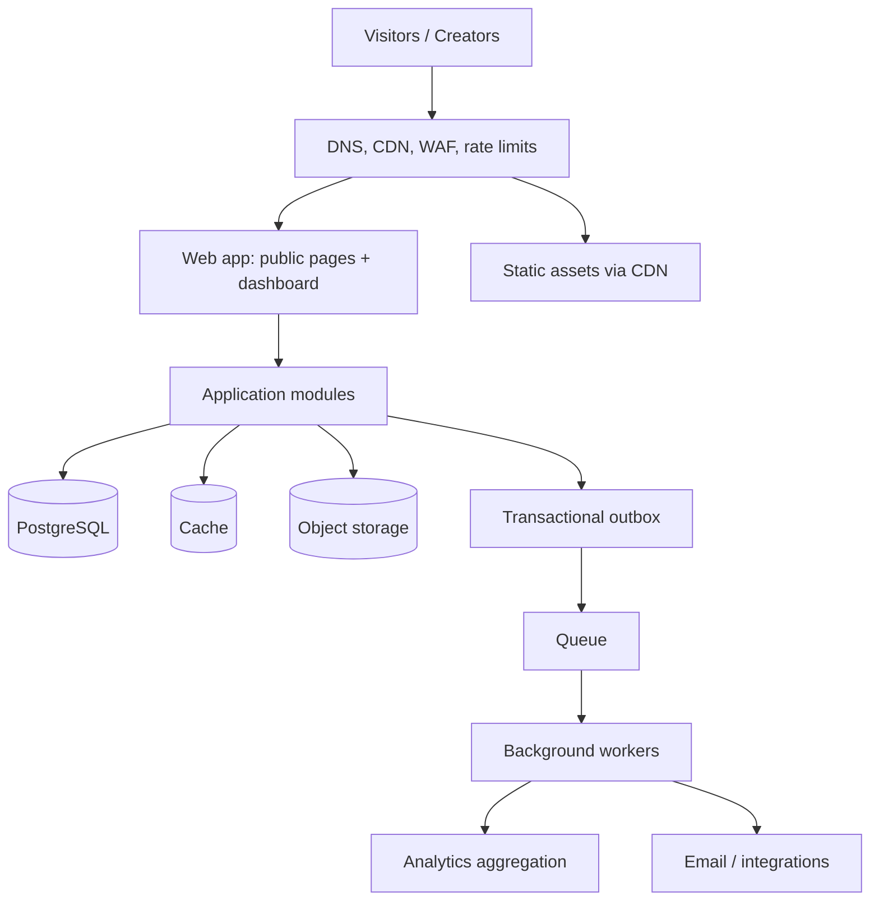

# Architecture

## 1. Architectural strategy

Start with a **modular monolith** and explicit domain boundaries. Deploy the web/API application as one unit initially, with background workers as a separate runtime when asynchronous work is introduced. Keep module contracts strict so a proven high-load or independently owned module can later be extracted.

Do not start with a fleet of microservices. Distributed transactions, network failures, deployment coordination, and observability are real costs. Scale by workload first, then extract services only when independent scaling, ownership, security, or reliability requirements justify it.

## 2. Logical architecture



This is a target logical view. Optional infrastructure should be added only when a feature needs it. The MVP can run without a dedicated queue, cache, analytics warehouse, or microservices.

## 3. Runtime boundaries

### Web application
- Serves dashboard and public profile pages.
- Performs authentication integration and request validation.
- Calls application use cases; route handlers must not contain business rules.
- Public page reads must be optimized and safely cacheable.
- No correctness-critical state may live only in process memory.

### Domain modules
Each module owns its business rules, schemas/DTOs, use cases, persistence interface, and authorization expectations. Modules must not reach into another module's tables through arbitrary queries or import its internal implementation.

Initial modules:
- **Identity & Accounts:** account lifecycle and authentication mapping.
- **Profiles:** profile settings, publication state, slug rules.
- **Links:** link validation, ordering, enabled state.
- **Themes & Media:** theme configuration and media metadata.
- **Analytics:** event intake, aggregation, retention.
- **Domains (later):** custom domain verification and routing.
- **Integrations (later):** provider adapters, webhooks, API keys.
- **Billing (later):** plans, entitlements, invoices, subscription lifecycle.
- **Teams (later):** organizations, memberships, roles, invitations.

### Background workers
Use workers for work that does not need to finish in the user request: analytics aggregation, email, previews, webhooks, imports, and scheduled actions. Workers must be safe to retry and must not assume exactly-once delivery.

## 4. Code organization

Suggested starting structure; adapt to the actual framework without forcing unnecessary packages:

```text
src/
  app/                         # Framework routes, pages, API handlers
  modules/
    identity/
      domain/
      application/
      infrastructure/
      presentation/
    profiles/
      domain/
      application/
      infrastructure/
      presentation/
    links/
      domain/
      application/
      infrastructure/
      presentation/
    analytics/
      domain/
      application/
      infrastructure/
      presentation/
  platform/
    database/
    cache/
    queue/
    security/
    observability/
    config/
    storage/
    testing/
  shared/
    contracts/                 # Truly shared stable primitives only
    errors/
    validation/
docs/
  adr/
tests/
  integration/
  e2e/
```

Avoid a giant `utils` directory. Shared code must be genuinely reusable and stable; otherwise keep it within its owning module.

## 5. Dependency rules

1. Presentation calls application use cases.
2. Application orchestrates domain rules and depends on interfaces for external capabilities.
3. Domain code contains business rules and must not import framework, database, cache, queue, or provider SDKs.
4. Infrastructure implements persistence and provider interfaces.
5. A module's internals are private; other modules use its public application contracts.
6. No direct cross-module table writes.
7. Avoid circular dependencies. If two modules need each other, introduce a clear contract or event.
8. Use dependency injection/composition at the application boundary.

## 6. Data and persistence

- PostgreSQL is the source of truth for accounts, profiles, links, permissions, and configuration.
- Use migrations committed to source control.
- Add constraints for invariants that the database can enforce: unique normalized usernames, foreign keys, required fields, and valid ordering keys where practical.
- Add indexes based on access patterns and query plans, not guesswork.
- Use cursor/keyset pagination for large or frequently changing lists.
- Use bounded connection pools and monitor connection saturation.
- Keep transactions short; never call a slow third-party API inside a database transaction.
- Design schema changes for expand/migrate/contract deployment.
- Backups, restore testing, and migration rollback/forward strategy are required.

## 7. Public page read path

1. Visitor requests a profile URL.
2. Edge layer applies TLS, WAF/bot rules, and rate limits.
3. Public rendering resolves the normalized slug and published profile.
4. Read path fetches only fields required for the public page.
5. Cache safe published output/data using a key that includes the profile identifier and content version.
6. On profile update/unpublish, invalidate or version the cached result.
7. Record analytics asynchronously where possible without delaying navigation.

Never cache private dashboard data in a shared public cache. Cache invalidation must account for unpublishing, deleted profiles, changed slugs, and disabled links.

## 8. Analytics ingestion

- Keep click redirect/navigation fast.
- Validate event type, profile/link relationship, and payload size.
- Apply rate limits and bot filtering.
- Send events to a queue or durable outbox when volume requires it.
- Consumers should be idempotent; duplicates can happen.
- Aggregate raw events into time buckets and define retention.
- Separate operational metrics from product analytics.
- Do not put unbounded high-cardinality visitor data into general application logs.

For the MVP, a simple database-backed event table may be sufficient. Move to a dedicated analytics store only when query patterns and event volume justify the cost.

## 9. Caching and queues

- Cache is an optimization, never the source of truth.
- Every cache entry needs a TTL or explicit invalidation/version strategy.
- Cache failures should degrade safely to the database within capacity limits.
- Queue messages should carry versioned, validated payloads and identifiers, not secrets.
- Configure retry limits, exponential backoff, dead-letter handling, queue age alerts, and idempotency.
- Use an outbox pattern when a database transaction must reliably trigger asynchronous work.

## 10. Scaling path

### Stage 1 — MVP
One modular application, PostgreSQL, object storage only if needed, CDN for static assets, automated tests, and basic observability.

### Stage 2 — Growth
Add caching for hot public profiles, rate limiting, database/query optimization, queue-backed analytics and email, worker autoscaling, and load testing.

### Stage 3 — High traffic
Scale stateless web instances horizontally, separate read-heavy workloads where useful, partition or archive event data based on measured growth, improve edge caching, and establish service-level objectives.

### Stage 4 — Very large scale
Extract only proven bottlenecks or independently operated domains, such as analytics ingestion, redirect/event processing, or domain routing. Define ownership, API/event contracts, data ownership, retries, timeouts, and migration plans before extraction.

## 11. Security

- Authorize every private operation on the server; never trust client-supplied owner IDs.
- Use secure, HTTP-only, same-site cookies when cookie-based sessions are selected.
- Protect mutation endpoints against CSRF where applicable.
- Validate URL schemes and reject dangerous schemes such as `javascript:`.
- Escape user-generated text and avoid rendering arbitrary user HTML.
- Rate-limit authentication, mutations, redirects, and event ingestion.
- Protect against username/profile enumeration and automated abuse.
- Verify custom-domain ownership before serving tenant content on a domain.
- Store secrets in deployment secret management.
- Use least-privilege credentials and redact tokens, cookies, and sensitive data from logs.
- Define account export/deletion and analytics retention policies.

## 12. Observability and reliability

- Structured logs with request/correlation IDs.
- Metrics for request rate, latency percentiles, error rate, database pool usage, cache hit ratio, queue age, retries, and worker failures.
- Distributed tracing when multiple runtimes/services make it useful.
- Alerts tied to user impact and service objectives.
- Health/readiness checks that do not leak internal details.
- Document incident response, backup restoration, and dependency failure behavior.

## 13. Testing strategy

- Unit tests for domain rules and validation.
- Integration tests for database constraints, repositories, and transaction behavior.
- API tests for authentication, authorization, input validation, rate limits, and error contracts.
- End-to-end tests for signup, profile editing, publishing, public rendering, and unpublishing.
- Load tests for public profile reads and click redirects.
- Migration tests against a clean database and a representative existing schema.
- Security tests for cross-account access and cache leakage.

## 14. Upgrade and API compatibility

- Keep domain models separate from HTTP response DTOs and persistence records.
- Version public APIs when breaking changes are unavoidable.
- Add optional fields before removing or renaming existing ones.
- Use expand/migrate/contract database migrations.
- Version queue/event payloads and make consumers tolerate unknown optional fields.
- Use feature flags for risky releases and gradual rollouts.
- Maintain an ADR for important choices and revisit decisions when evidence changes.

## 15. Architecture exit criteria

Do not extract a module into a service until at least one of these is demonstrated:
- It needs a distinct scaling profile that the monolith cannot meet economically.
- It needs an independent availability/security boundary.
- It has a separate team and ownership model.
- Its release cadence or failure modes materially impede the rest of the product.

Any extraction must include a data ownership plan, contract tests, observability, retries/timeouts, deployment strategy, and rollback path.